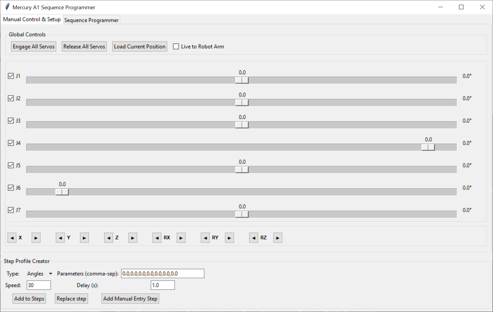
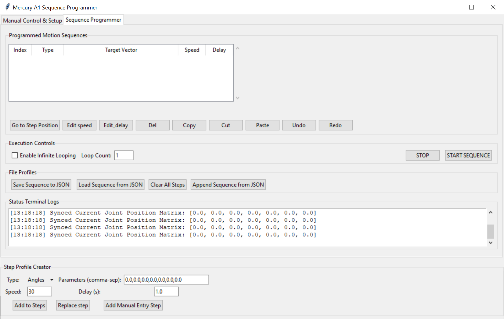

# mercury_sequence_ui

## Description
The Mercury-A1 robotic arm by Elephant Robotics comes with a raspberry pi computer (M5Stack CM4Stack) which is Linux based and has a touch screen for user operation.
I found the touch screen interface limiting.
The attached python code uses the preinstalled pymycobot.py library to display a Tkinter gui on an externally attached screen to control the robot using mouse and keyboard.
The library is in active development and can be found at https://github.com/elephantrobotics/pymycobot/tree/main
To update the library without connecting to the internet, replace the pymycobot folder at /home/er/,local/lib/python3.8/site-packages
## Using
The screenshots above were from a Windows dummy run, so the Linux version looks slightly different.
On start, if the "Live to Robot Arm" is checked, then moving the joint sliders will move the robot at the current speed setting.
Clicking on Release All Servos will cause the robot arm to flop, often resulting in joints going out of limit. As an alternative, each of the joints has a check box which can be used to free just that joint.
The arrow buttons below the slider move the end of the robot arm using the inbuilt reverse kinematic algorithm, but this is not overly accurate.
There are very few occasions where the "Load Current Position" button is useful, as for most operations, the sliders are updated automatically.
For both the "Manual Control & Setup" tab and the "Sequence Programmer" tab, the current position can be added to the sequence using the buttons at the bottom.
Moving to the "Sequence Programmer" tab, the top tree shows the programmed sequence.
For many operation, multiple steps can be selected.
"Go to Step Position" will go to the top selected position.
Edit speed and Edit_delay will change the speed and delay on the selected steps.
Del, Copy and Cut work as you would expect (related keyboard keys should work).
Paste puts the clipboard in front of the current selected item.
Append Sequence from JSON can be used to join different sequences together.
Everything else should be fairly obvious.
## Autostart
One of the reasons for creating this software was to allow autostart of a movement sequence on the robot arm. This has not been implemented in this version, but to automatically run this software at boot time, add the autorun.desktop file to /home/er/.config/autostart and edit it to point to the autorun.sh script.
This should work with a warm reboot, but for a cold boot some extra steps are/maybe necessary. See changes that need to be made in the system configuration in FixingAutoStart.txt

